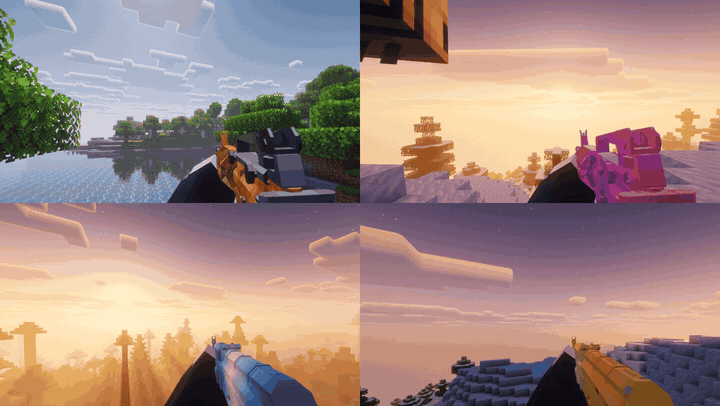
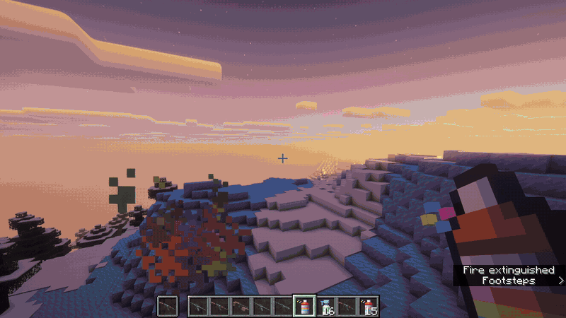
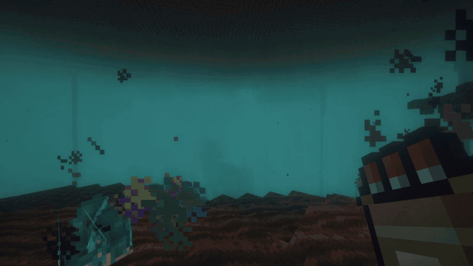
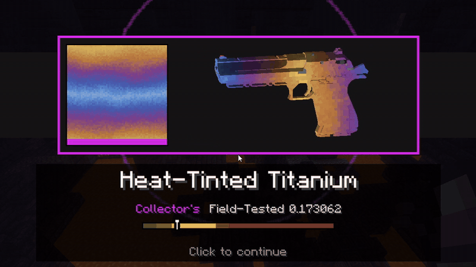

# 发愤涂枪（TaCZ Spray Paint）

[English](README.md) | 中文

[永恒枪械工坊：Zero](https://modrinth.com/mod/timeless-and-classics-zero)（TaCZ）的附属 mod，为枪械添加喷漆外观。

## 物品

- **喷漆罐**：给枪喷一个随机外观。每个外观的图案、等级和磨损分别随机，因此每把枪的结果都不相同。同一把枪可以反复喷涂。
- **喷漆箱**：一次给出十个外观，玩家从中选择一个应用到枪上。
- **去漆剂**：清除枪上的外观。

使用方法：主手持有物品，副手持枪，长按右键。每次使用消耗一个。喷涂后会显示喷好的枪和磨损；按任意键可以跳过，结果会发送到聊天栏。

外观只改变颜色，不改变模型、动画、声音和枪械属性。

## 配置

本 mod 通过 `config/taczspray/` 中的文件进行配置，不需要编写代码。客户端也不需要额外安装任何内容：玩家进入服务器时，服务端会把自定义外观发送给客户端。

- **自定义外观**：一个文件夹，内含可平铺的 `pattern.png` 和简短的 `finish.json`。
- **系列**：一组外观及其概率，类似武器箱。
- **指定外观的喷漆罐**，以及用于商店、开箱、奖励的 `/taczspray give` 指令。
- **设置**：合成开关、等级与磨损的概率、普通喷漆罐的抽取范围。

详见[配置说明](docs/server-owners.zh_cn.md)（[English](docs/server-owners.md)）。首次启动时，mod 也会把配置说明和几个示例写入 `config/taczspray/examples/`。

## 语言

英文和简体中文为人工撰写。其余 18 种是 TaCZ 自带的语言，由机器翻译，再逐条回译检查。「枪」沿用 TaCZ 的译法，「主手」「副手」沿用 Minecraft 的译法，使两个 mod 在同一语言下用词一致。

欢迎指正翻译。每种语言是 `src/main/resources/assets/taczspray/lang/` 中的一个文件，游戏内按 F3+T 可重新加载。文件中缺少的条目显示为英文。

## 下载

[GitHub Releases](https://github.com/ryuka-dev/TaCZSprayPaint/releases)

## 运行环境

- Minecraft 1.20.1，Forge 47
- 永恒枪械工坊：Zero 1.1.8-hotfix、1.1.8-hotfix2 或 1.2.0-hotfix（未经修改的正式版）
- 服务端和客户端都需要安装

## 许可证

代码：GPL-3.0，与永恒枪械工坊：Zero 相同。

`src/main/resources/assets/taczspray/finishes/` 中的外观数据由 TaCZ 默认枪包的模型生成。对每把可喷涂的枪，它以本 mod 自己的格式保存被喷涂的面的角点与贴图坐标，以及需要上色的贴图像素。该枪包由 Serene Wave Studio 与 Timeless Squad 制作（美术：NekoCrane、Receke、Pos_2333），采用 [CC BY-NC-ND 4.0](https://creativecommons.org/licenses/by-nc-nd/4.0/) 许可，因此这些数据以同一许可分享，仅限非商业用途。数据中不包含其贴图的任何像素：外观是在玩家本机上，喷涂到随 TaCZ 安装的贴图上的。
